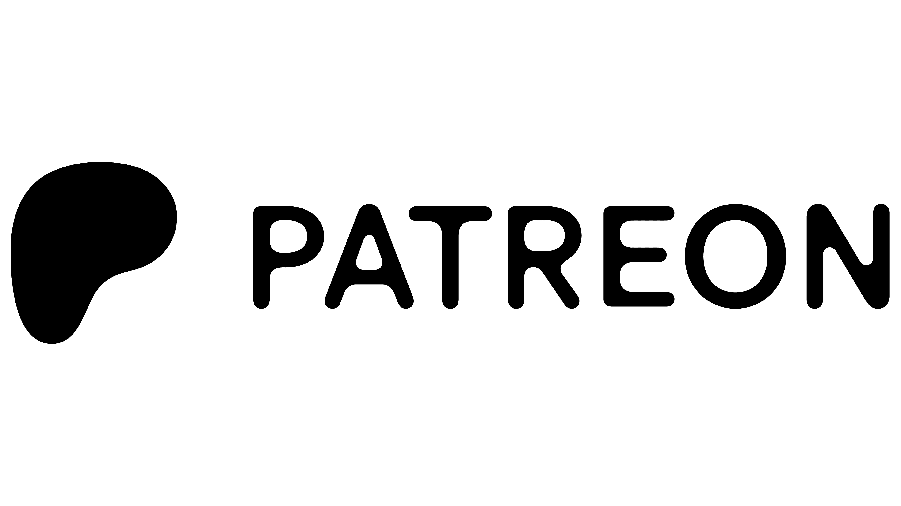

# Shadowrun 5e Charactermancer for Foundry VTT

A Foundry VTT v14 module that walks you through *Shadowrun, Fifth Edition* character creation for the [Shadowrun 5e system](https://github.com/SR5-FoundryVTT/SR5-FoundryVTT), from concept to a finished character sheet. It supports the core Priority system and the alternate methods from *Run Faster*: Sum to Ten, Point Buy and Life Modules.

- Module by: Geek IO Dev Team
- Requires: the **Shadowrun 5th Edition** system (0.37 or later)
- Recommended: **Shadowrun 5e Compendium** (`sr5compendiumfoundry`) for qualities, spells, adept powers and gear to pick from

## Installing

In Foundry, go to **Add-on Modules → Install Module**, paste this manifest URL and click **Install**:

```
https://github.com/geek-io/sr5charactermancerfoundry/releases/latest/download/module.json
```

Foundry will offer updates from the same URL when a new version is released.

## How to use

1. Enable **Shadowrun 5e Charactermancer** in **Manage Modules**.
2. Click **Charactermancer** at the top of the Actors sidebar.
3. Work through the steps on the left: concept and method, priorities and metatype, Life Modules (for that method), Magic or Resonance, attributes, qualities, skills, knowledge and languages, resources and gear, contacts, and the final review.
4. Keep an eye on the side panel. It shows every budget (Karma, points, nuyen, Essence, qualities) and lists the rule problems that still need fixing. Hover over almost anything for an explanation.
5. On **Final Review**, click **Create character**. The finished actor opens with its attributes, skills, qualities, spells, powers, gear, lifestyle and contacts filled in.

**Players.** With **Players can open the Charactermancer** on (Game Settings → Module Settings, on by default), players see the button too. Players without Foundry's "Create New Actors" permission can still finish a character: a connected GM's client creates it and gives the player ownership, so a GM must be online.

**Saving and sharing.** Your build is saved to your own user as you go, so you can close the window and pick it up later. **Save to chat** posts the build as a chat card. Anyone can click **Open in Charactermancer** on it to load their own copy, for example to have the GM review a build or to start from a template. **Start over** clears your build.

**Creation methods.**

| Method | Source | Budget |
| --- | --- | --- |
| Priority | SR5 p.62 | A–E once each across five columns, plus 25 Karma |
| Sum to Ten | Run Faster p.62 | 10 priority points (A = 4 … E = 0), plus 25 Karma |
| Point Buy | Run Faster p.64 | 800 Karma |
| Life Modules | Run Faster p.65 | 750 Karma and a life history |

Street-Level and Prime Runner games change the Karma, Resources, Availability and contact limits (SR5 p.64).

[Official Geek IO Discord Link](https://www.geek-io.net/discord)  

All my work is always free, but a little bit of help is always appreciated!  
<a href="https://patreon.com/geekioshow"></a>

# v 0.1.5

- **Install from a manifest URL.** The module is now released on GitHub, so any Foundry v14 server can install it with **Install Module** and the manifest URL above, and get updates from Foundry's update check.

# v 0.1.4

- **Builds belong to the user who made them.** Each user's work in progress is stored on their own user, tagged with their id, and replaced in full on every save, so leftovers from earlier edits can't come back. The Charactermancer never loads a draft that belongs to someone else. Drafts from earlier versions are moved over automatically.
- **Save to chat.** The new **Save to chat** button posts a card with the character's name, method, metatype, Magic type, Karma left and whether it's ready to create. Anyone, player or GM, can click **Open in Charactermancer** on the card to open a copy of that build. The copy becomes their own draft, so changing it never touches the original. If you already have a build in progress, you're asked before it's replaced.
- **Tooltips.** Hover over things to see what they mean:
  - priority cells, creation methods and gameplay levels
  - metatypes: attribute ranges, racial traits, Karma cost and lifestyle multiplier
  - Magic types, attributes, skills and skill groups: limits and Karma costs
  - column headings and the side panel's budgets
  - spells, powers, qualities and gear, in the browsers and in your lists: the item's full compendium description and source page
  - why a quality can't be taken

# v 0.1.3

- **Life Module qualities no longer count against the quality limits.** Qualities granted by Life Modules are paid for by the module, so they no longer use up the 25 Karma positive or 25 Karma negative limits, the quality browser's remaining room, or the Qualities budget in the side panel.
- **Teen Years choices stay put.** On Magical Education, picking a skill group or skill for your magical training erased the training choice itself, so the selection disappeared when you moved to another step. Choices nested under a variant are now stored separately. If a saved draft lost its choice, pick the magical training again.

# v 0.1.2

- **Players can open the Charactermancer.** With **Players can open the Charactermancer** on (the default), every player sees the button. Players who don't have Foundry's "Create New Actors" permission build their character as usual. When they click **Create character**, a connected Gamemaster's client creates the actor, gives the player ownership and, if the player has no character yet, assigns it to them. A GM must be online for this.
- **All spellcasting traditions.** The Tradition list now has 70 traditions: the core Hermetic and Shamanic, all of *Street Grimoire*, *Shadow Spells*, *Forbidden Arcana* (including the variant paths), *Hard Targets*, *Dark Terrors* and the other supplements. Each shows its Drain attributes and source page and sets the actor's Drain attribute. **Custom** lets you pick the Drain attribute yourself.
- **Spell and power filters.** The Magic step's browser filters by source book, category (combat, detection, health, illusion, manipulation), mana or physical, direct or indirect, range, duration and maximum Drain (for example "F−2 or less"). Adept powers filter by maximum Power Point cost and active or passive. Results show category, type, range, duration and Drain at a glance. Spells already in your list are left out.
- **Spell costs shown.** The Magic step shows how many spells you know, the Karma they cost and your Magic × 2 limit. Priority builds count the free spells from the Magic/Resonance priority first. Point Buy and Life Modules give no free spells (Run Faster p.64), so every spell costs 5 Karma, and the step now says so.
- **Qualities split into Positive and Negative.** Your chosen qualities and the browser results are shown in separate Positive and Negative columns, each with the Karma room left under the 25 Karma limit. The browser filters by source book.
- **Only qualities you can take.** The browser hides qualities you can't afford (over the 25 Karma limits or your remaining Karma) or don't qualify for: adept-only Ways for non-adepts, Awakened-only qualities for mundanes, technomancer-only Resonant Streams, Magic Resistance for the Awakened, metatype-limited qualities (Elf Poser, Ork Poser, Human-Looking, Infected), SURGE qualities without Changeling, qualities you already have and the Magician/Adept/Technomancer qualities set on the Magic step. Tick **Show qualities I can't take** to see them greyed out with the reason.
- Qualities that appear in several books are listed once.

# v 0.1.1

**Fixes for opening the Charactermancer.**

- The **Charactermancer** button now opens the window. Before, it failed with "Cannot set property state of ApplicationV2".
- Opening it no longer shows a stack of "Cannot use 'in' operator to search for 'source'" errors. The item browser no longer asks the compendiums for each item's source page, which some compendium entries store in an unexpected format.

# v 0.1.0

**The first Charactermancer.** Open it with the **Charactermancer** button at the top of the Actors sidebar. It follows the nine creation steps of the core rules (SR5 pp.62–107) and builds a ready-to-play `character` actor.

- **Four creation methods.**
  - **Priority** (SR5 p.62): click the Priority Table to assign A–E once each to Metatype, Attributes, Magic or Resonance, Skills and Resources.
  - **Sum to Ten** (Run Faster p.62): spend 10 points (A = 4, B = 3, C = 2, D = 1, E = 0). Levels can repeat; each column is still chosen once.
  - **Point Buy** (Run Faster p.64): start with 800 Karma and buy everything at advancement costs, with up to 235 Karma turned into nuyen.
  - **Life Modules** (Run Faster p.65): start with 750 Karma and pick a Nationality and region, Formative Years, Teen Years, optional Further Education and any number of Real Life modules.
- **Gameplay levels.** Street-Level, Experienced Runner (standard) and Prime Runner change starting Karma, the Resources column, the Karma-to-nuyen limit, maximum Availability and device ratings, and contact Karma (SR5 p.64).
- **Metatypes, metavariants, metasapients and shapeshifters.** Human, elf, dwarf, ork and troll, plus every metavariant (gnome, hanuman, koborokuru, menehune, dryad, nocturna, wakyambi, xapiri thëpë, nartaki, hobgoblin, ogre, oni, satyr, cyclops, fomorian, giant, minotaur), the centaur, naga, pixie and sasquatch, and all ten shapeshifters, with their attribute ranges, racial traits, special attribute points at each priority, extra Karma costs and Point Buy costs (Run Faster pp.64, 104–107). Metavariants are written to the sheet as their base metatype; metasapients and shapeshifters as human, with the traits in the biography.
- **Magic or Resonance.** Magician, Mystic Adept, Adept, Aspected Magician and Technomancer from the Priority Table, or as the Run Faster qualities (Magician 30, Mystic Adept 35, Adept 20, Aspected Magician 15, Technomancer 15 Karma). Choose the free skills or aspected group your priority grants, a tradition for Drain, and spells, rituals, complex forms and adept powers from any Shadowrun compendium. Free spells and forms are counted first, then 5 or 4 Karma each; adept power points and the mystic adept's bought power points are tracked.
- **Attributes.** Attribute and special attribute points, Karma raises at new rating × 5, metatype minimums and maximums, the one-attribute-at-maximum rule, and Exceptional Attribute and Lucky.
- **Life Modules.** All 4 nationalities with their regions and languages, 10 Formative Years, 10 Teen Years, 5 Further Education modules with their disciplines and vocations, and 21 Real Life modules with their roles and branches. Fill in names such as [City] or [Corporation], make the "pick two attributes" and "spread 13 points" choices, and the module checks the order rules (Military Academy, Mercenary, Private Investigator, Postgraduate, Preparatory School, Medical Corps). Skills raised inside a skill group break the group, as on Run Faster p.65; active skills cap at 7 and knowledge at 9, and the highest SIN replaces the others.
- **Qualities.** Browse every quality in your Shadowrun compendiums or drag them in, with the 25 Karma positive and 25 Karma negative limits.
- **Skills.** Skill points, group points, specializations (1 skill point or 7 Karma), Karma at new rating × 2 or × 5, the Aptitude maximum, broken groups, and the Adept and Aspected Magician skill restrictions.
- **Knowledge and languages.** Free points equal to (Intuition + Logic) × 2, Karma beyond that, and a free native language (two with Bilingual).
- **Resources and gear.** Search or drag in weapons, armor, cyberware, bioware, devices and equipment. Set quantity, rating, cost, Availability and, for 'ware, Essence and grade (used, alpha, beta, delta). The step checks Availability for the gameplay level, Essence and the Magic it costs, the lifestyle (including dwarf and troll lifestyle multipliers), the 5,000¥ carry-over, and rolls starting nuyen for your lifestyle (SR5 p.95).
- **Contacts.** Connection + Loyalty, with Charisma × 3 free Karma (× 6 for Prime Runners).
- **Final review.** Attributes, skills, qualities, limits, condition monitors, Initiative, a full Karma ledger and the 7 Karma carry-over. **Create character** stays locked until every error is fixed.
- **The finished actor.** Attributes, Edge, Magic or Resonance, metatype, Awakened type and Drain attribute, Karma and nuyen are written to the sheet. Skill ratings and specializations go onto the system's own skill items, intact skill groups are added as group items, and knowledge skills and languages are added. Qualities (including Life Module qualities and the Magic quality), spells, powers, gear, the lifestyle and contacts are added as items. The biography records the method, priorities, Life Modules and the Karma and nuyen totals.
- **Drafts are saved.** The build is saved to your user as you go, so you can close the window and come back to it. **Start over** clears it.
- A world setting lets the GM hide the button from players.
